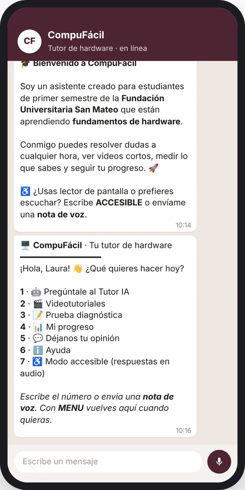
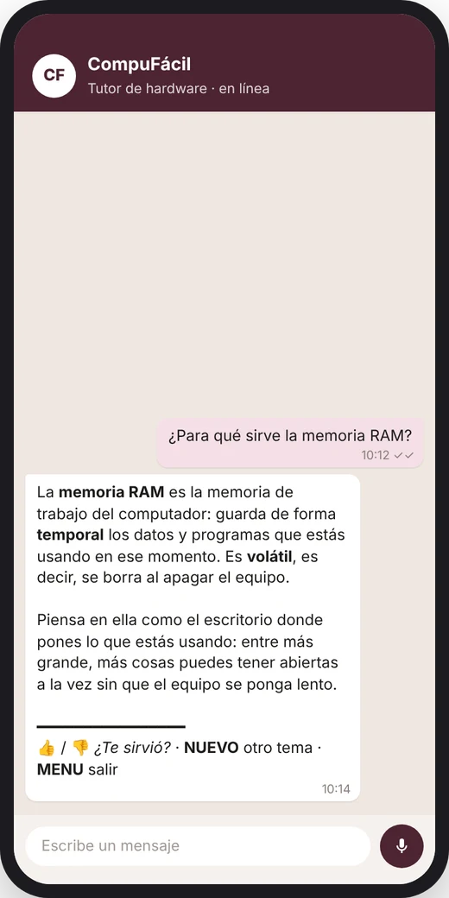
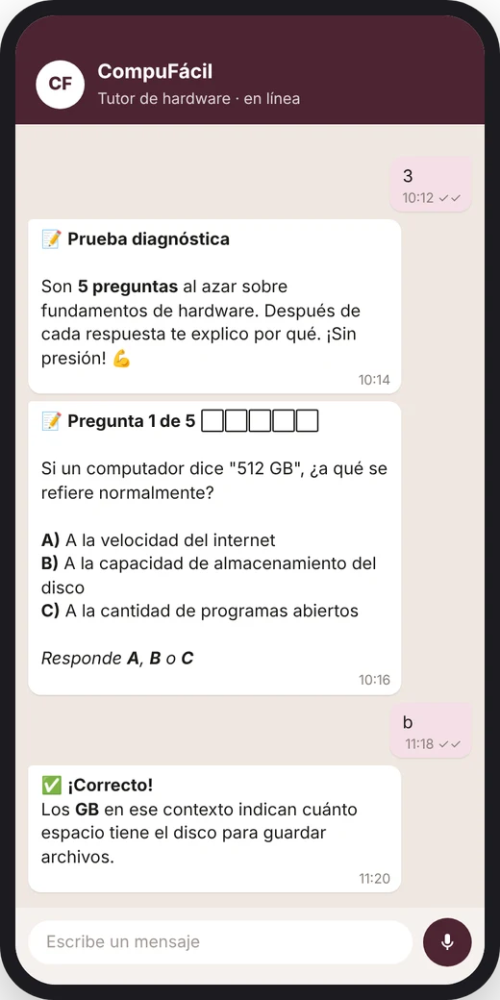
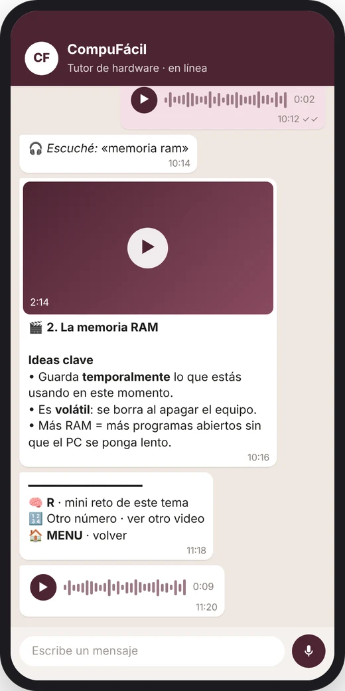
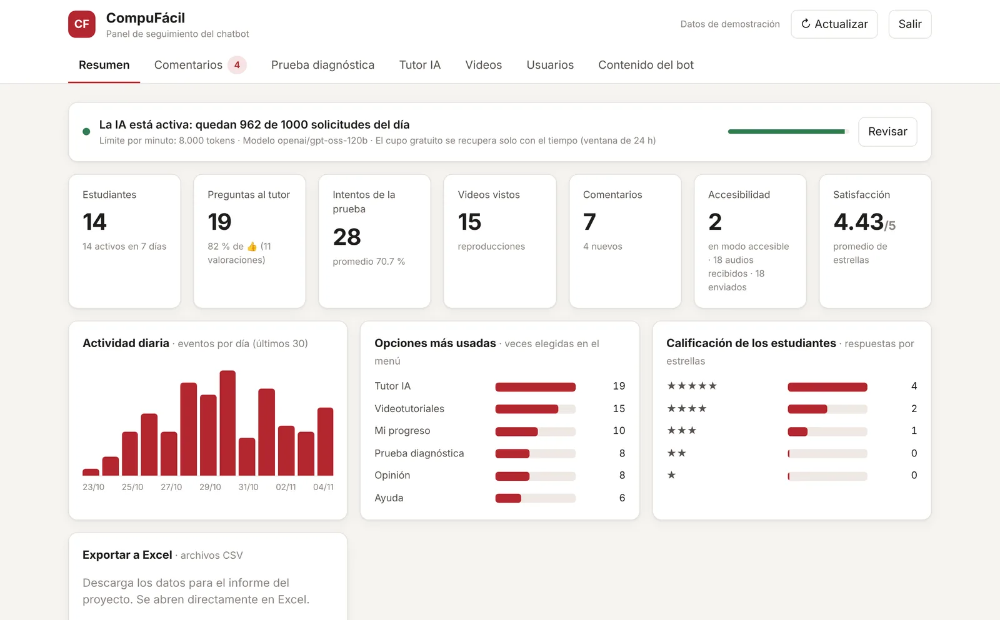
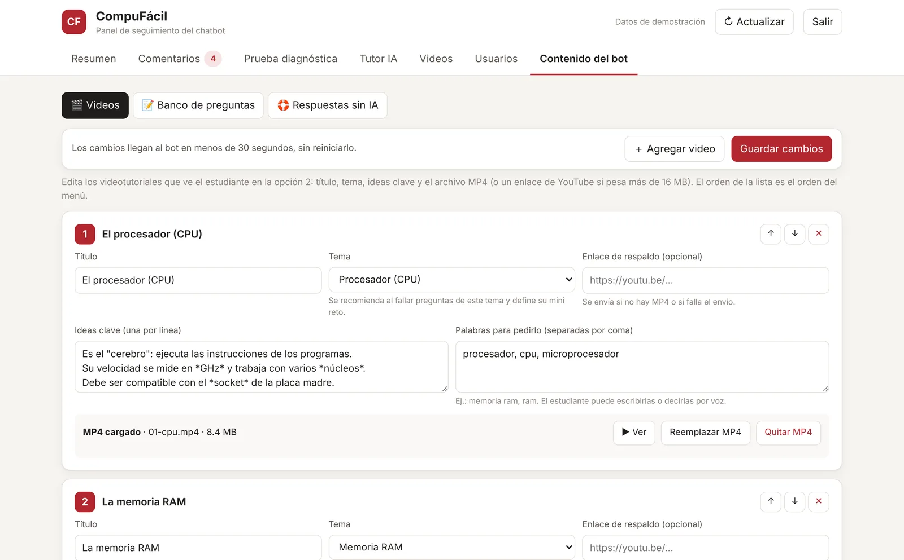

# CompuFácil 🖥️ — Tutor de hardware en WhatsApp

CompuFácil acompaña a estudiantes de primer semestre de Ingeniería de Sistemas
de la **Fundación Universitaria San Mateo** en los fundamentos de hardware.
Desde WhatsApp, sin instalar nada, el estudiante puede:
- resolver dudas con un tutor de inteligencia artificial;
- ver videotutoriales cortos;
- presentar una prueba diagnóstica;
- seguir su progreso;
- dejar su opinión.

Puede escribir o hablar. El docente sigue todo desde un panel web, y desde ahí
también administra los videos, las preguntas y las respuestas del bot.

🌐 **Presentación del proyecto:** https://angaritha.github.io/CompuFacil/

<p align="center">
  
  
  
  
</p>

## Qué hace

| Opción del menú | Función |
|---|---|
| 1 · 🤖 Tutor IA | Responde preguntas de hardware con analogías y **recuerda la conversación**. *NUEVO* empieza otro tema; 👍/👎 califican la respuesta. |
| 2 · 🎬 Videotutoriales | 8 temas, del procesador al ensamble. El video llega **dentro del chat** con sus ideas clave y un **mini reto** (*R*). |
| 3 · 📝 Prueba diagnóstica | 5 preguntas al azar de un banco de 20, de temas distintos. Explica cada respuesta en el momento y al final recomienda videos según lo que falló. |
| 4 · 📊 Mi progreso | Intentos, promedio, tendencia, temas por reforzar, videos vistos y preguntas hechas al tutor. |
| 5 · 💬 Opinión | Calificación de 1 a 5 estrellas, categoría y comentario libre. |
| 6 · ℹ️ Ayuda | Instrucciones y comandos. |
| 7 · ♿ Modo accesible | Mensajes sin emojis ni adornos, pensados para lectores de pantalla, y cada respuesta también en **nota de voz**. |

### 🎙️ Voz y accesibilidad
- **Notas de voz en cualquier momento.** Se transcriben con Whisper (Groq) y el bot confirma lo que escuchó («🎧 Escuché: …»). Sirve decir "menú", "opción tres", "la be"…
- **Respuesta en audio.** Si el estudiante habla, el bot contesta con **una sola nota de voz** que resume todo su turno. Usa voz neural en español de Colombia (edge-tts) y, si esa falla, gTTS.
- **Entiende palabras aproximadas.** Tolera errores de escritura y de pronunciación y elige la opción más parecida: "prueva", "tress", "memoria ram" → video 2, "excelente" → 5 estrellas. Si duda entre dos opciones, vuelve a preguntar.
- **Comandos de voz y lectura.**
  - *AUDIO* lee en voz alta el último mensaje.
  - *ACCESIBLE* y *NORMAL* activan o desactivan el modo accesible, que se recuerda por estudiante.

### 📊 Panel web para el docente
Se abre en `http://localhost:8000/panel` o en la dirección HTTPS del servidor, y pide clave. En *Resumen* muestra si WhatsApp está conectado y, si hace falta, el **QR para vincularlo**. Tiene estas pestañas:

| Pestaña | Qué muestra |
|---|---|
| **Resumen** | Indicadores de uso, actividad diaria, opciones más usadas, satisfacción y **estado de la IA** (si la clave funciona y cuánto cupo queda). |
| **Comentarios** | Las opiniones de los estudiantes, con filtros y estados *nuevo / leído / resuelto*. |
| **Prueba diagnóstica** | Aciertos por tema, preguntas más difíciles e intentos. |
| **Tutor IA** | Cada pregunta con su respuesta y su valoración 👍/👎; se puede filtrar por las que se respondieron sin IA. |
| **Videos y Usuarios** | Reproducciones por video y actividad de cada estudiante. |
| **Contenido del bot** 🆕 | El docente administra el contenido sin tocar código (ver la tabla siguiente). |
| **Ajustes** 🆕 | Clave de la IA (Groq) y clave del panel, sin tocar archivos. |

En **Contenido del bot** se puede:

| Sección | Qué permite |
|---|---|
| **Videos** | Subir, reemplazar, ver o quitar el MP4. Cambiar título, tema, ideas clave, palabras para pedirlo y orden. Poner un enlace de YouTube como respaldo. |
| **Banco de preguntas** | Agregar, editar o eliminar preguntas de la prueba y de los mini retos, con respuesta correcta, explicación y porcentaje de acierto. |
| **Respuestas sin IA** | Las respuestas por palabra clave que usa el tutor cuando se agota el cupo de la IA o no hay internet. Tiene un **probador** para ver qué respondería el bot. |

Los cambios llegan al bot en menos de 30 segundos, sin reiniciarlo. Todo se
puede **exportar a Excel (CSV)** para los informes.

<p align="center">
  
  
</p>
<p align="center"><sub>Capturas con datos de demostración.</sub></p>

## Arquitectura

```
                      ┌──────────────────────────────────────────┐
WhatsApp ⇄ bot/ (Node.js + WPPConnect) ⇄ ia/ (Python + FastAPI) ⇄ Groq
  texto y               menú, prueba,      tutor con memoria,      ├─ GPT-OSS 120B (tutor)
  notas de voz          videos, voz,       datos (SQLite),         └─ Whisper (voz → texto)
                        contenido en vivo  panel web, voz (TTS)
```

```
CompuFacil/
├── CompuFacil.exe           ← doble clic para arrancar todo (Windows)
├── iniciar_compufacil.bat   alternativa en dos ventanas
├── index.html, img/         página de presentación (GitHub Pages)
├── launcher/                código del lanzador (Go)
├── deploy/oracle/           instalación en servidor (Oracle Cloud, 24/7)
├── ia/
│   ├── main.py              API + panel
│   ├── ia_service.py        Tutor IA (Groq), respuestas sin IA y estado del cupo
│   ├── content_admin.py     Contenido administrable (videos, preguntas, respuestas)
│   ├── db.py                Base de datos SQLite
│   ├── voice.py             Notas de voz: transcripción y síntesis
│   ├── panel.html           Panel web
│   ├── .env                 Claves (no se sube a GitHub)
│   └── .env.example         Plantilla del .env
└── bot/
    ├── bot.js               Conexión con WhatsApp
    ├── flows.js             Conversación (menú, tutor, videos, prueba, opinión, voz)
    ├── intent.js            Interpretación de palabras aproximadas
    ├── content.js           Contenido de fábrica (temas, videos, banco de preguntas)
    ├── contentSync.js       Aplica en vivo los cambios hechos en el panel
    ├── api.js / state.js    Comunicación con la API y estado por usuario
    ├── assets/videos/       MP4 de los videotutoriales
    └── test/                Simulaciones sin WhatsApp
```

## Instalación local (Método 1, una sola vez)

Requisitos:
- **Node.js 18+**
- **Python 3.10+**
- una clave gratuita de **Groq** (https://console.groq.com/keys)

```bash
# Motor de IA
cd ia
python -m venv venv
venv\Scripts\activate          # Windows
pip install -r requirements.txt

# Bot
cd ../bot
npm install
```

Crea `ia/.env` a partir de `ia/.env.example`. Allí pon tu `GROQ_API_KEY` y, si
quieres, una `PANEL_PASSWORD` propia (por defecto `compu2026`).

## Dos formas de ponerlo en marcha

| | **Método 1 · En tu PC (local)** | **Método 2 · Servidor Oracle Cloud (24/7)** |
|---|---|---|
| Cuándo usarlo | Demostraciones y pruebas | Uso real con estudiantes |
| Encendido | Mientras el PC esté prendido | Siempre, con reinicio automático |
| Costo | Gratis | Gratis (Oracle *Always Free*) |
| Panel | `http://localhost:8000/panel` | `https://<ip>.sslip.io/panel`, con HTTPS |
| Vincular WhatsApp | QR en la ventana del lanzador | QR en el panel (*Resumen*) |

### Método 1 · En tu PC (local)

**Doble clic en `CompuFacil.exe`.** En una sola ventana:

1. Revisa las dependencias e instala solo lo que cambió.
2. Enciende el motor de IA y el panel.
3. Comprueba la clave de Groq y cuánto cupo gratuito queda hoy.
4. Conecta el bot de WhatsApp. La primera vez aparece un QR: escanéalo desde WhatsApp → *Dispositivos vinculados*.
5. Abre el panel en el navegador.

Para apagar todo, cierra la ventana o presiona Ctrl+C. Los registros completos
quedan en `logs/`. La sesión de WhatsApp se guarda en `bot/tokens/`.

**Manual:**

```bash
cd ia && python main.py      # terminal 1
cd bot && node bot.js        # terminal 2, cuando la anterior diga "Uvicorn running"
```

### Método 2 · Servidor Oracle Cloud (24/7)

El bot queda encendido todo el tiempo en una máquina gratuita de Oracle Cloud:
Ubuntu, ARM, 2 núcleos y 12 GB de RAM. Un solo script instala todo. La guía
paso a paso está en [`deploy/oracle/LEEME.md`](deploy/oracle/LEEME.md).

1. Crea una cuenta en https://signup.cloud.oracle.com.
2. Crea una instancia **Ubuntu 24.04** de tipo **VM.Standard.A1.Flex** (2 OCPU, 12 GB). En *Script de inicialización* pega:
   ```bash
   #!/bin/bash
   curl -fsSL https://raw.githubusercontent.com/angaritha/CompuFacil/HEAD/deploy/oracle/install.sh | bash
   ```
3. En la red de la instancia (*Security List*), abre los puertos **80** y **443** (TCP).
4. Espera unos 10 minutos y entra a `https://<ip-con-guiones>.sslip.io/panel`; por ejemplo, la IP `129.1.2.3` queda como `129-1-2-3.sslip.io`.
5. En el panel:
   - **Ajustes:** pega tu clave de Groq y cambia la clave del panel.
   - **Resumen:** escanea el QR desde WhatsApp.

**Cómo queda instalado:**
- El bot y la IA corren como servicios (`compufacil-bot` y `compufacil-ia`) que se reinician solos si fallan o si la máquina se reinicia.
- Solo el panel queda en internet, protegido con HTTPS (Caddy) y clave, con bloqueo tras varios intentos fallidos. La API del bot sigue siendo local.
- Para actualizar con lo último de GitHub: `sudo compufacil-actualizar`. Conserva los datos, los videos y las claves.

> Para el servidor conviene un **número de WhatsApp dedicado al bot**: el bot
> usa WhatsApp Web (WPPConnect, no oficial) y desde un servidor en la nube el
> riesgo de bloqueo es algo mayor.

### Cupo de la IA (Groq)

El plan gratuito de Groq no se paga ni se recarga: tiene límites que se
recuperan solos, en una ventana de 24 horas.

| Uso | Límite aproximado |
|---|---|
| Tutor (`openai/gpt-oss-120b`) | 1.000 preguntas al día y 8.000 tokens por minuto |
| Notas de voz (Whisper) | 2.000 transcripciones al día |

El lanzador y el panel muestran el cupo restante. Si se agota, el tutor usa las
**respuestas sin IA**, que se editan en el panel.

## Personalizar el contenido

Lo normal es hacerlo desde el **panel → Contenido del bot**: videos, preguntas y
respuestas sin IA.

| Qué cambiar | Dónde |
|---|---|
| Valores de fábrica, que se cargan la primera vez | `bot/content.js` |
| Personalidad del tutor | `SYSTEM_PROMPT` en `ia/ia_service.py` |
| Voz | `TTS_VOICE` en `ia/.env` |

## Probar sin WhatsApp

Con el servicio de IA encendido:

```bash
cd bot && npm test            # conversación completa simulada
node test/sim_voice2.js       # audios y palabras aproximadas
```

## Solución de problemas

| Síntoma | Solución |
|---|---|
| El lanzador dice "clave no válida" | Crea otra clave en https://console.groq.com/keys y ponla en `ia/.env`. |
| El tutor responde con textos genéricos | Se agotó el cupo de Groq o no hay internet; se recupera solo. Mientras tanto edita las *Respuestas sin IA* en el panel. |
| El QR no aparece o expira | Cierra CompuFácil, borra `bot/tokens/` y vuelve a abrirlo. |
| No llega el video | El MP4 debe pesar menos de 16 MB. Si pesa más, comprímelo o usa un enlace de YouTube en el panel. |
| No llegan las notas de voz del bot | Vuelve a abrir `CompuFacil.exe`, que actualiza las dependencias, y revisa el internet. |
| En el servidor no carga el panel | Revisa que los puertos 80 y 443 estén abiertos en la *Security List* de Oracle. El registro de la instalación está en `/var/log/compufacil-install.log`. |
| En el servidor el bot no responde | `sudo systemctl status compufacil-bot` y `sudo journalctl -u compufacil-bot -n 50`. |
| "Contenido del bot" aparece vacío | Enciende el bot una vez: carga los videos y preguntas de fábrica. |
| Windows avisa "protegió su PC" | *Más información* → *Ejecutar de todas formas*. El .exe no está firmado digitalmente. |

## Privacidad

- Los datos de los estudiantes quedan solo en el equipo (`ia/compufacil.db`).
- El panel exige clave y muestra los números de teléfono abreviados.
- `.gitignore` excluye la base de datos, la sesión de WhatsApp, los videos y las claves.

---
Proyecto integrador de la Especialización en Docencia · Fundación Universitaria
San Mateo · Juan Felipe Angarita Cepeda y Luis Miguel Umaña Suárez.
